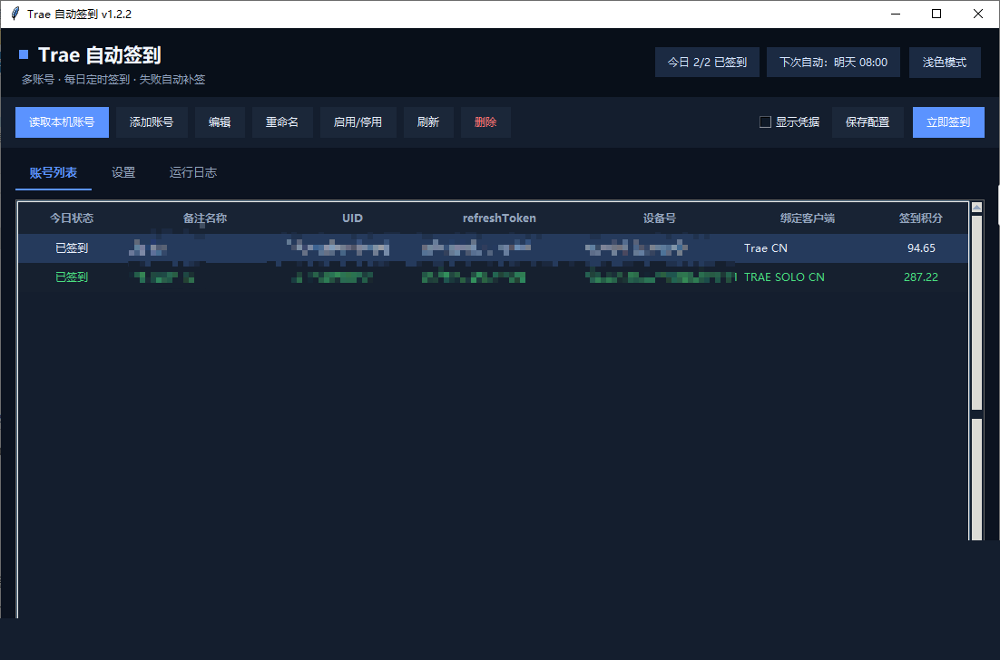
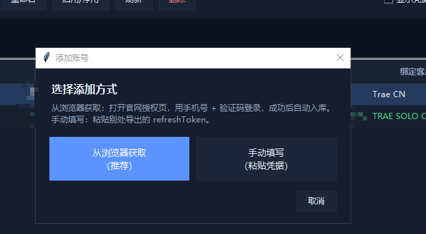
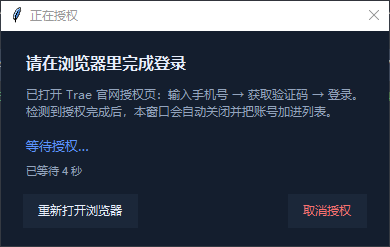
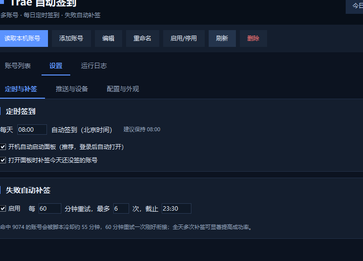
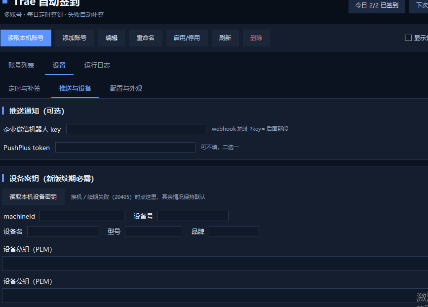
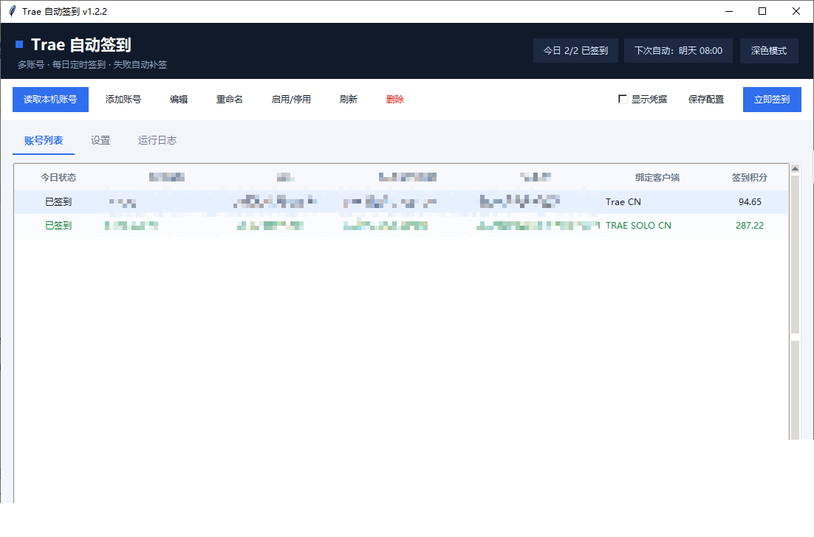

# Trae 自动签到 · 多账号管理面板

Trae（Trae CN / TRAE SOLO CN）每日签到、多账号管理、免客户端加号、一键换号。
Windows 桌面面板 + 纯命令行两种用法，零第三方依赖，只要有 Python 3.8+。

**本项目由 AI 开发。**

> 下载：[最新发行版](https://github.com/Damianjiang/Trae-AutoCheckin/releases/latest) —— 解压后双击 `启动签到面板.vbs` 即可，无需安装依赖。


<p align="center">
  
</p>

---

## 能做什么

| 能力 | 说明 |
| :-- | :-- |
| 每日自动签到 | 到点自动签；启动失败 5 分钟后重试，签不上自动补签，结果落盘可查 |
| 多账号 | 一台电脑管多个号，相邻账号固定错开 1 秒（`TRAE_GAP_SEC` 可调），避开 9074 排队限流 |
| 免客户端加号 | 网页授权登录，本地自造设备身份，不用装/开/关 Trae |
| 一键换号 | 把面板里的任意账号写进客户端并重启，失败自动回滚 |
| 账号绑定 | 每个号绑定到具体客户端（Trae CN / SOLO CN）并带上设备密钥，专治 20403 |
| 推送通知 | 企业微信机器人 / PushPlus，签到结果直达手机 |
| 深浅色面板 | 卡片式界面，深色/浅色一键切换，选择会记住；「刷新」会去服务端拉最新积分 |

---

## 界面预览

| 添加账号（二选一） | 浏览器授权中 |
| :--: | :--: |
|  |  |

| 右键菜单 | 定时与补签 |
| :--: | :--: |
|  |  |

| 推送与设备密钥 | 浅色主题 |
| :--: | :--: |
|  |  |

---

## 快速开始

### 方式一：图形面板（推荐）

1. 安装 Python 3.8+（安装时勾选 *Add Python to PATH*）；
2. 双击 **`启动签到面板.vbs`**；
3. 「账号列表」→「读取本机账号」，会自动读到你当前登录的号；
4. 点「立即签到」即可，之后可以交给定时任务。

### 方式二：命令行 / 青龙面板

```bash
python trae_checkin.py
```

账号凭据通过 `TRAE_ACCOUNTS` 环境变量传入（JSON 数组），也兼容
`TRAE_REFRESH_TOKEN`、`TRAE_ACCESS_TOKEN`、`TRAE_CONFIG` 等旧写法。

```bash
# 从本机客户端一键生成 TRAE_ACCOUNTS
python trae_get_token.py --accounts

# 只导出设备密钥（换机续期用）
python trae_get_token.py --export-keys
```

---

## 三种添加账号的方式

点「添加账号」会先让你选入口：**从浏览器获取**（推荐，自动入库）或 **手动填写**（粘贴凭据）。

| 方式 | 适合场景 | 入口 |
| :-- | :-- | :-- |
| 读取本机账号 | 已经在客户端登录过 | 面板「读取本机账号」 |
| 从浏览器获取 | 客户端没登过 / 想加小号 | 「添加账号」→「从浏览器获取」，或 `python trae_weblogin.py --login 备注名` |
| 手动填写 | 从别的机器导出的 refreshToken | 「添加账号」→「手动填写」 |

浏览器登录只需要手机号 + 短信验证码，全程在浏览器里完成。点「从浏览器获取」后会弹出一个
进度窗（可「重新打开浏览器」或「取消授权」），检测到授权完成就自动关窗并把账号加进列表；
备注名**留空**时会自动用登录账号的昵称。全程**不会启动、也不会关闭你正在用的 Trae**。

选中一行后可以用上方按钮操作，也可以**右键**：重命名备注、编辑凭据、切换到此账号、
启用/停用、复制 UID、刷新列表、删除账号。

---

## 续期身份与签到设备号（9074 的真正原因）

这两个是**不同的东西**，混用就会天天 `9074`：

| 字段 | 作用 | 能不能改 |
| :-- | :-- | :-- |
| `deviceId` / `realDeviceId` + `deviceKeyPem`/`devicePubPem` | 签发 token 的那套身份，续期必须用它 | **不能**，改了续期报 20403 / 10101 |
| `checkinDeviceId` | 签到请求里的 `x-device-id` | 必须是**客户端真实注册号** |

「从浏览器获取」的账号会自造一套设备身份（16 位号 + 自造密钥）去换 token。这套号能续期，
但签到接口只认客户端注册过的号 —— 自造号一律被判 `9074`（同账号同时刻对照实测）。

所以现在签到设备号是自动推导的，顺序为：

1. 配置里的 `checkinDeviceId`；
2. **本机正登录着这个 uid 的客户端当前注册号**（自动纠正，不用手填）；
3. `.trae_checkin_devices.json` 里上次确认可用的号（客户端没登录时也不会丢）；
4. 账号自带的真实号。

命中 `9074` 时只会在同账号的真实号之间换，**绝不改续期身份**。

### 能不能「完全伪造」一个设备号？

不能，这是服务端的设计，不是格式问题。把客户端 `main.js` 反查下来，链路是这样的：

| 环节 | 客户端实际行为 |
| :-- | :-- |
| 本地设备号 | `aha.device.device_id` 里存 `{"device_id_str":"1000000000000002","install_id_str":...}`，由客户端本地 SDK 生成 |
| 发号 | 客户端启动时由 `iCubeDeviceRegister` 服务向设备登记服务注册，拿到 `guaranteedDeviceId`（`aha-<32hex>`） |
| 签到 | `x-device-id = guaranteedDeviceId`，走 `/trae/api/v2/ug/checkin_credits/claim` |

也就是说这个号是客户端通过**设备登记服务**产生并注册的，不是本地随便算一个哈希就能冒充的：
我们试过 md5 / sha1 / sha256 对 machineId、devDeviceId、sqmId、hostname、`device_id_str` 做各种拼接，全部 0 命中。

实测对照（同账号、同时刻、同 token，只换 `x-device-id`）：

| 设备号 | 结果 |
| :-- | :-- |
| 自造 16 位数字（网页登录时生成） | 连续 4 轮 `9074` |
| 客户端真实注册号 | `http=200 code=0 success`，积分到账 |

自造的 `aha-<32hex>` 格式与客户端一致，但同样没有登记记录，不能指望它被认可。

另外两条也验证过是死路，别再折腾：

- 网页登录的 `ExchangeToken` 虽然把自造 DeviceID 写进了 `DeviceInfo`，但**不会**把设备登记进签到服务；
- 对**今天已经签过**的账号，随便换什么号 claim 都回 `code=0`（幂等假成功），不能用它判断设备是否被认可 —— 必须用「今日未签」的账号才能验证。

所以本项目的做法是**把伪造层做到与客户端同构，并优先复用本机已登记号**：

- `trae_weblogin.py` 自造身份改成 `aha-<32hex>` + 本机真实 `telemetry.machineId`（同格式、同指纹风格）；
- 签到号优先用「本机正登录这个 uid 的客户端注册号」，其次上次可用号，最后才是自造号；
- 启动前可以自检，一眼看出哪个号会 9074：

```bash
python trae_checkin.py --check-devices
```

输出会逐账号列出「续期身份 / 签到设备号（来源）/ 今日状态 / 结论」，只读不发 claim。

> 想 100% 不 9074，唯一可靠前提是：该账号在 Trae 客户端里登录过，机器上有它的注册设备号。
> 网页登录的账号请补登一次客户端，或先把 `checkinDeviceId` 填成机器上已有的真号。

---

## 账号绑定与 20403

一台机器上 `Trae CN` 和 `TRAE SOLO CN` 可能注册**同一个设备号**，但各自生成不同的
密钥对。只按设备号匹配就会拿到另一份私钥，续期报：

```
refresh http=401 code=20403 Token device not match.
```

现在这么处理：

- 添加/编辑账号时可以指定 **绑定客户端**，并一键「读取该号的设备密钥」；
- 面板启动时会给缺绑定/缺密钥的账号自动补全（优先选「当前正登录着这个号」的客户端）；
- 签到脚本续期时按可信度逐个尝试设备身份，被 20403/10101/20405 拒掉就换下一套，
  签成功的那套会写回账号，之后直接命中。

---

## 换号（冷切换）

「账号列表」选中账号 → 右下「切换到此账号」：

1. 结束正在运行的客户端；
2. 备份当前登录态到 `.trae_switch_backups/`（只留最近 10 份）；
3. 以当前 `storage.json` 为骨架，重写三个身份键并用 Km 加密写回；
4. 拉起客户端，核对落盘 uid 是否为目标账号，**不符自动回滚**。

```bash
python trae_switch.py --status            # 看客户端当前是哪个号
python trae_switch.py --switch 备注名      # 切换
python trae_switch.py --rollback 备份目录  # 手工回滚
```

> 切换会结束客户端进程，未保存的编辑器内容会丢失，操作前请先保存。

---

## 常见状态码

| 码 | 含义 | 处理 |
| :-- | :-- | :-- |
| `9004` / `9095` | 本设备今日已签到 | 正常，不是失败 |
| `9074` | 参与用户太多（排队限流） | 自动换号重签，或等冷却后补签 |
| `20403` | token 与设备不匹配 | 见上一节「账号绑定」 |
| `20405` | 缺少设备证明 | 补设备密钥：`python trae_get_token.py --export-keys` |
| `10101` / `20101` | refreshToken 不匹配 / 已失效 | 重新登录该账号 |

---

## 目录结构

```text
Trae-AutoCheckin/
├── trae_gui.py             # 桌面面板
├── 启动签到面板.vbs         # 双击启动（自动找 Python）
├── trae_checkin.py         # 签到主脚本（命令行 / 青龙 / Actions）
├── trae_weblogin.py        # 网页登录加号（免客户端）
├── trae_switch.py          # 换号（冷切换 + 回滚）
├── trae_km.py              # storage.json 的 Km 编解码
├── trae_autologin.py       # 隔离配置目录启动客户端（备用方案）
├── trae_get_token.py       # 本机凭据 / 设备密钥提取
├── trae_sms_login.py       # 独立网页 OAuth 工具
├── trae_credit_monitor.py  # 积分只读监控
├── 配置生成器/              # 可视化生成 TRAE_CONFIG
└── tests/                  # 离线回归测试
```

运行期生成的文件（账号配置、token 缓存、备份、设备私钥）都已加入 `.gitignore`，
不会进入仓库。

---

## 关键词

Trae、Trae CN、TRAE SOLO、自动签到、每日签到、积分、积分领取、多账号、多开、账号切换、
换号、免登录、网页授权、OAuth、PKCE、refreshToken、accessToken、设备身份、设备指纹、
deviceId、20403、20405、9074、青龙面板、GitHub Actions、Windows 桌面工具、Python、
tkinter、自动化脚本、Trae 助手、IDE 工具。

---

## 免责声明

本项目仅供个人学习与自动化实践使用。请遵守 Trae 官方的用户协议；因使用本工具导致的
账号异常、积分变动或其它后果，由使用者自行承担。请勿用于商业用途或批量注册。

## License

[MIT](LICENSE)
